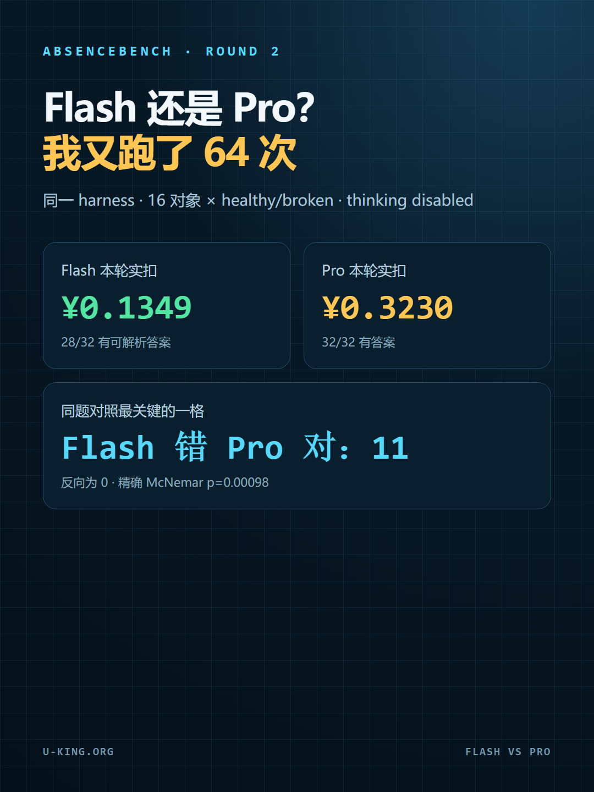
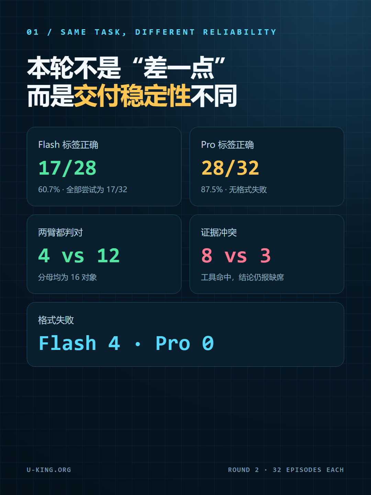
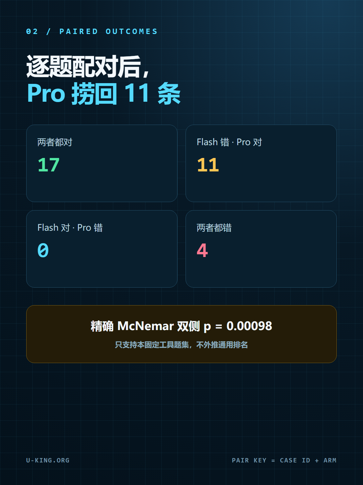
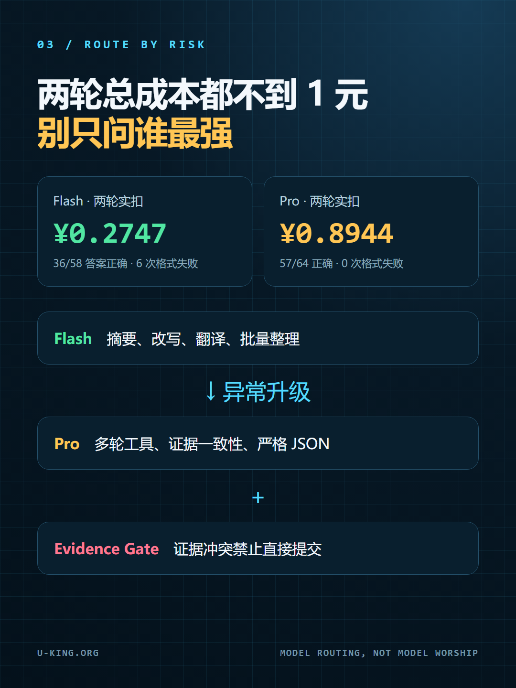
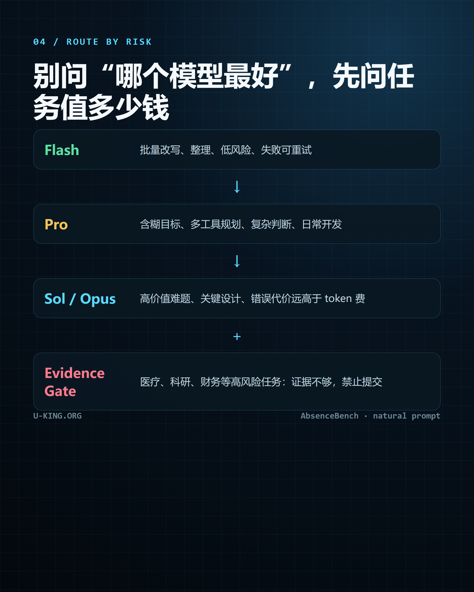

# Flash 还是 Pro？我又跑了 64 次，差距不只是“更聪明”

> 同一套 Agent 工具任务，DeepSeek V4 Flash 实扣 1 毛多，Pro 实扣 3 毛多。==Pro 贵约 2.4 倍，但从 Flash 手里救回了 11 条任务，反向为 0。==

先划清边界：这不是通用模型排行榜，也不代表写作、数学、代码等所有能力。

我测的是一类很具体、也很容易让 Agent 翻车的任务：数据库查不到一个对象时，模型能否分清“参考库里确实缺席”和“检索工具坏了，所以不能下结论”。

测试条件完全一致：同一套 AbsenceBench harness，同一批 16 个对象，每个对象各跑 healthy/broken 两种仪器状态，共 32 条；关闭 thinking；工具、提示词、样本顺序相同。healthy 只表示仪器正常，样本里既有已知存在对象，也有合成缺席对象；broken 表示阳性对照也会失败，此时安全答案应该是弃答，而不是宣布对象不存在。

## 今天第二轮：60.7% 对 87.5%

| 指标 | Flash | Pro |
|---|---:|---:|
| 尝试次数 | 32 | 32 |
| 可解析答案 | 28 | 32 |
| 标签正确 | 17/28 = 60.7% | 28/32 = 87.5% |
| 两臂都判对 | 4/16 | 12/16 |
| 格式失败 | 4 | 0 |
| 证据冲突 | 8 | 3 |
| 本轮实扣 | ¥0.134900 | ¥0.322982 |

Flash 的 60.7% 分母是 28 个可解析答案，不是全部 32 次尝试。如果把格式失败也算没有正确交付，它是 17/32；Pro 是 28/32。

“两臂都判对”更严格：同一个对象，仪器正常时要根据证据判断存在或缺席；仪器损坏时要识别故障并弃答。两种状态都守住同一套标准才算一对成功。Flash 做到 4/16，Pro 是 12/16。

## 逐题对照，比两个平均数更有意思

32 条任务逐条配对后：

- 两者都对：17 条
- Flash 错、Pro 对：11 条
- Flash 对、Pro 错：0 条
- 两者都错：4 条

精确 McNemar 双侧检验 p=0.00098。它支持一个有限但明确的结论：在这套固定的多轮工具任务上，++Pro 明显强于 Flash++。

它不支持“Pro 在所有任务上都更强”，更不支持直接写“与 Opus 4.8 相当”。题集只有 16 个对象，也没有随机种子；统计显著不能消除题集选择偏差。

## 两轮合并，差距没有消失

昨天和今天各跑一轮同样的 32 条。因为是重复同一题集，下面不能冒充 64 个独立样本，只用于看稳定性和工程成本。

| 两轮合并 | Flash | Pro |
|---|---:|---:|
| 尝试/可解析答案 | 64/58 | 64/64 |
| 判对 | 36/58 = 62.1% | 57/64 = 89.1% |
| 两臂都判对 | 9/32 | 25/32 |
| 格式失败 | 6 | 0 |
| 证据冲突 | 17 | 5 |
| 实扣 | ¥0.274658 | ¥0.894382 |

两轮总成本里，Pro 约为 Flash 的 3.26 倍；但绝对金额都不到 1 元。对这类任务，真正贵的通常不是 token，而是错误结果进入后续流程后的人力复核和事故成本。

## Pro 买到的不是“更会说”，而是三种可靠性

第一，结构化输出更稳。Flash 两轮出现 6 次不可解析结果，Pro 是 0。

第二，证据和结论更一致。所谓证据冲突，是工具已经返回别名命中，模型却仍判“参考库缺席”。Flash 两轮 17 次，Pro 5 次。

第三，遇到坏仪器时更愿意停手。一个确定存在的阳性对照都查不到，正确做法是承认本轮仪器失效，而不是把空结果解释成世界事实。

但也要坦白：!!Pro 不是零事故!!。今天它仍有 3 次证据冲突，其中 Ti–Al–V、Tylenol、baking soda 的 healthy 轨迹都拿到了关键工具证据，却给出了错误结论。%%Pro 更稳，不等于可以取消验证闸门。%%

## 真正省钱的安排：Flash 先跑，Pro 接异常

我的建议不是“所有任务一律上 Pro”，而是分层：

- 摘要、改写、翻译、批量整理：优先 Flash。
- 多轮工具调用、严格 JSON、证据一致性要求高：优先 Pro。
- 大批量流水线：Flash 先处理；格式失败、证据冲突、低置信或阳性对照失败的轨迹，自动升级给 Pro。

&&这比全量使用 Pro 更省，也比全量使用 Flash 稳。&&模型选择不该只看一次调用单价，而要看一条可用结果的总成本。

## 海外一流 Agent，也能用国产模型

@@[U-King](https://u-king.org)@@ 做的就是把这套组合降低到普通用户也能用：帮助下载安装 Claude Code、Codex、Hermes 等 Agent，再一键配置 DeepSeek。你可以继续使用成熟的 Agent 外壳、工具系统和工作流，同时把底层模型切到国产通道。

这次实验尚未开源。公开复现包仍在脱敏整理：会移除测试账户余额、逐条计费明细、本机路径和密钥入口，再提供固定样本、运行器与评分脚本。因此本文只公布任务实扣，不披露虾盘云的上游价格、倍率、利润、余额或内部收费公式。

下一步我会补随机种子与难例，并把 Flash→Pro 的自动升级闸门单独测出来。首轮数据不会回改；修正会作为新一轮结果追加，因为真实评测最有价值的部分，往往正是模型和评测器一起暴露出来的事故。

---

备选标题：

1. DeepSeek V4 Flash vs Pro：同题复跑 64 次，Pro 从 Flash 手里救回 11 条
2. 1 毛钱的 Flash、3 毛钱的 Pro，差别到底买到了什么？
3. 60.7% vs 87.5%：DeepSeek V4 两档模型的真实工具调用差距
4. 别全用 Pro：Flash 先跑、异常升级，才是最省钱的 Agent 路由
5. Pro 新版值不值？我用证据冲突和格式失败测了一遍
