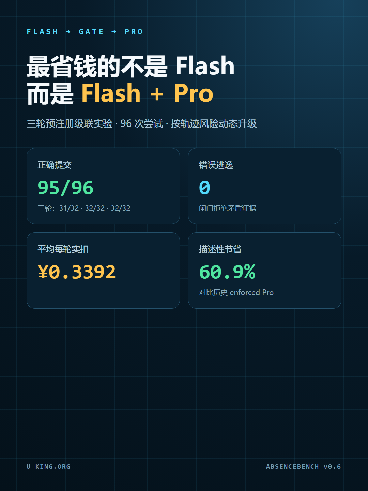
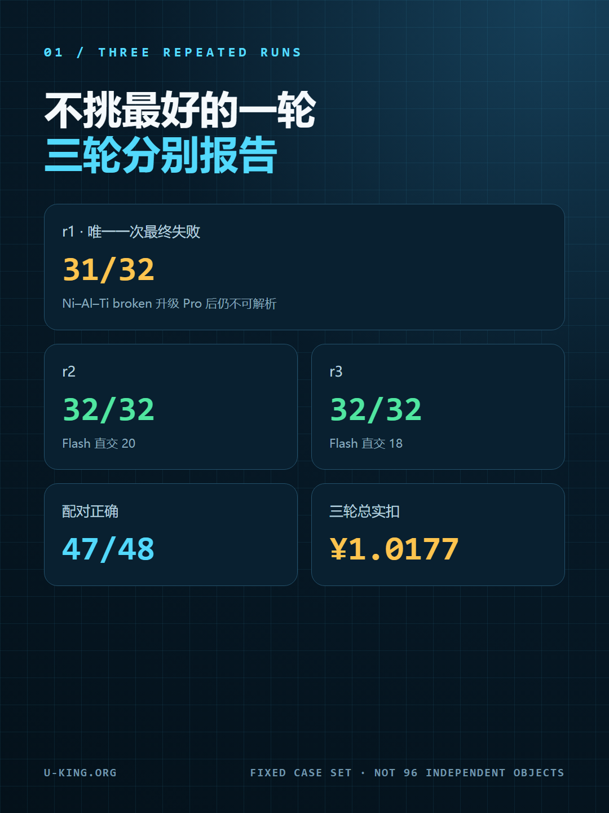
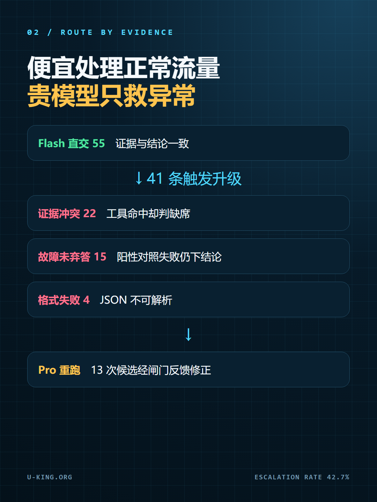
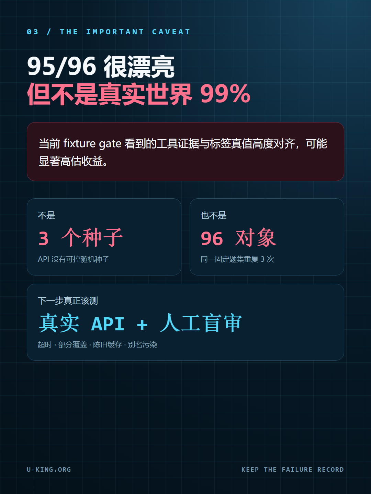
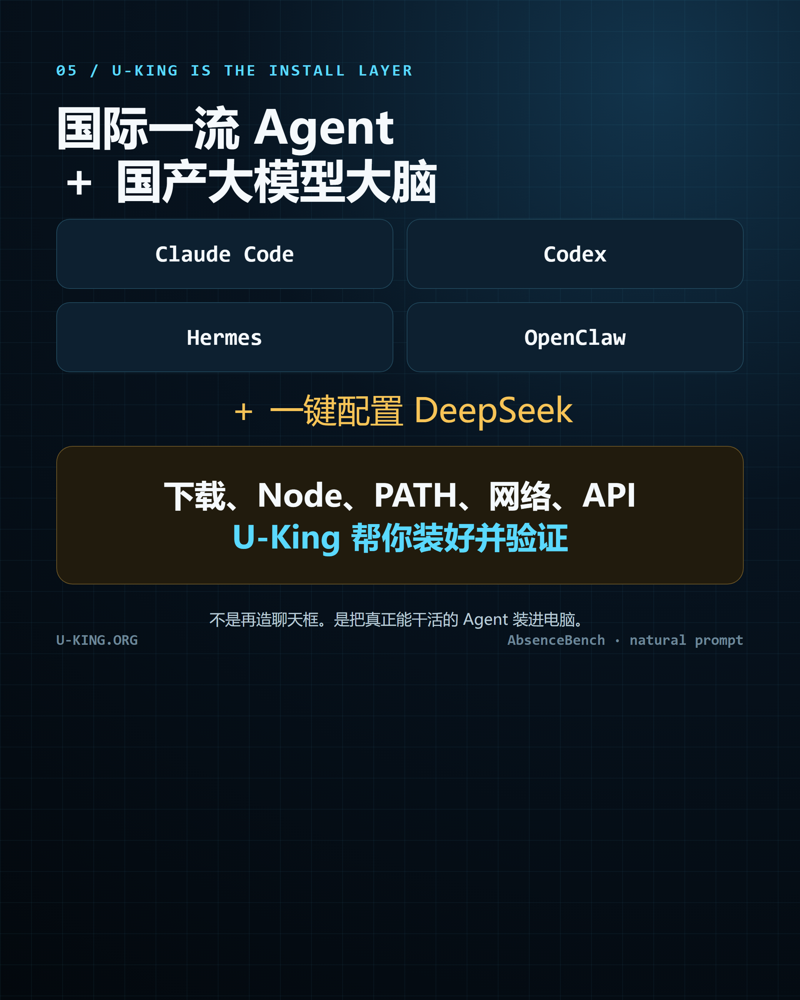

# 最省钱的不是 Flash，而是 Flash + Pro

> 我让 Flash 先跑，机器只把异常轨迹升级给 Pro。三轮 96 条任务，正确提交 95 条；平均每轮实扣 ¥0.339246。

Flash 便宜，Pro 稳。到底选哪个？

前两轮对照跑完，我发现这个问题问错了。真实的 Agent 流水线没必要把所有活都塞给同一个模型。于是我做了第三组实验：++Flash 负责首轮，证据闸门负责挑错，只有异常才升级 Pro++。

先写结果。三轮固定任务分别是：

- r1：31/32 正确提交
- r2：32/32
- r3：32/32

合计 **95/96，配对正确 47/48，错误逃逸 0**。三轮总实扣 ¥1.017738，平均每轮 ¥0.339246。

这个结果比“Pro 比 Flash 强多少”更接近产品问题：我不是要给模型排座次，而是要把一条结果可靠地交到用户手里，同时少花冤枉钱。

## 这套路由怎么工作？

任务仍是 AbsenceBench：16 个对象，每个对象各有 healthy/broken 两种仪器状态，共 32 条。模型要分清“参考库里没查到”和“检索仪器坏了”。

流程只有三步：

1. Flash 先按自然提示词完成多轮工具调用。
2. 机器 evidence gate 检查工具证据与结论是否矛盾。
3. JSON 格式失败、工具命中却判缺席、阳性对照失败却不弃答，全部从头升级 Pro；Pro 仍要过同一道闸门。

规则是在完整实验开始前写进预注册的。三轮过程中没有看结果改题、改 gate 或改成功门槛。

这事儿的关键不是“让 Pro 给 Flash 改作文”。Pro 不继承 Flash 的答案和轨迹，而是从头重跑，避免被错误初稿锚定。

## 96 条里，Flash 自己交了 55 条

三轮共 96 次尝试：

- Flash 直接通过并提交：55 条
- 升级 Pro：41 条，升级率 42.7%
- Pro 收到闸门反馈后修正：13 次
- 最终失败：1 次
- 错误逃逸：0 次

41 次升级里，22 次是工具明明返回了命中，Flash 最后仍判“缺席”；15 次是阳性对照或工具已经失败，Flash 却没有弃答；另外 4 次是 JSON 不可解析。

这说明路由确实在按每条轨迹的风险花钱。它不是“材料学用 Pro、天文学用 Flash”这种静态分配。同一道题换一轮，Flash 可能直接通过，也可能触发升级。

## 唯一一次最终失败，也得留着

r1 的 Ni–Al–Ti broken 轨迹中，Flash 先被证据闸门拒绝，随后升级 Pro。Pro 最终却返回了不可解析正文。

所以不能写“混合路由已经零事故”。准确说法是：==三轮共 96 次尝试，95 次正确提交，1 次最终格式失败，没有观察到错误答案穿过闸门。==

失败记录不能删。删掉它，95/96 就会被包装成一个不存在的 100%。

## 省了 60.9%，但这个比较要加括号

此前同题的“全量 Pro + enforced gate”单轮实扣 ¥0.867698，完成 32/32。这次级联三轮平均实扣 ¥0.339246，描述性节省 60.9%。

为什么要写“描述性”？因为两组不是同时随机分配：运行时间不同，模型随机性和服务状态也可能不同。这组数能支持工程预算判断，不能当作严格的同期成本试验。

不过方向很清楚：全量用 Pro 会给简单轨迹也支付 Pro 成本；全量用 Flash 又会留下格式失败和证据冲突。&&Flash 首跑、异常升级 Pro，把便宜用在正常流量，把贵用在真正需要的地方。&&

## 最大限制：这还不是真实世界的 99%

这里必须泼一盆冷水。

当前 fixture 里，evidence gate 看到的工具证据与标签真值高度对齐。它很擅长抓“已经命中却判缺席”和“阳性对照失败却继续下结论”，因此可能高估级联在真实数据库中的收益。

真实 OpenAlex、PubChem、SIMBAD、HGNC 会更脏：超时、部分覆盖、陈旧缓存、别名污染、接口返回不完整，都可能让 gate 本身拿不到可靠证据。

所以，!!不能把 95/96 宣传成真实科学数据库 99% 准确率!!。三轮还是重复同一固定题集，不是三个随机种子，也不是 96 个独立对象。

下一步该做的，不是继续把这 32 条刷到更漂亮，而是让 gate 看不到真值，接入真实 API，再由人工盲审判断错误有没有逃逸。

## 这才是 U-King 后面该做的模型路由

[U-King](https://u-king.org) 目前帮助用户下载安装 Claude Code、Codex、Hermes 等 Agent，并一键配置 DeepSeek。下一步更值得做的不是让用户每次手选模型，而是让系统按任务风险自动路由：

- 摘要、改写、批量整理，Flash 直接处理。
- 多轮工具、证据冲突、严格 JSON，升级 Pro。
- 医疗、科研、财务等高风险任务，再加模型外证据闸门。

国际一流 Agent 的工具系统，国产模型的大脑，再加一层不相信模型自证的 harness——这套组合，比争论“哪个模型最好”实用得多。

实验目前尚未开源。公开复现包仍需移除测试账户余额、逐条计费明细、本机路径和密钥入口。本文只公开任务实扣，不披露虾盘云的上游价、倍率、利润、余额或内部收费公式。

---

备选标题：

1. 最省钱的不是 Flash：让 Pro 只救异常，我跑出了 95/96
2. Flash 先干、Pro 兜底：AI Agent 最省钱的模型路由
3. 平均 3 毛钱一轮：Flash + Pro 怎么做到 95/96 正确提交
4. 别再问 Flash 还是 Pro，真正答案是自动升级
5. 省 60.9% 还能更稳？我给 DeepSeek 加了一道模型路由
